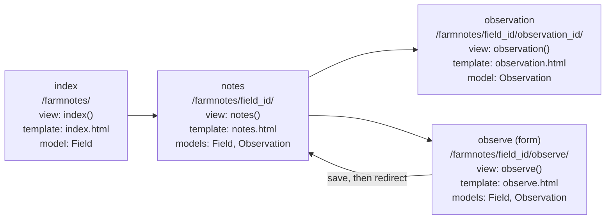

# Demo: Bootstrap + Django

ASM 532 - Module 5 - Lab 5 session 1 (TA demo) and Lecture 5.3

This is the demo from class. Poke around at your own pace. Nothing here is graded.

`myapp` is the Module 4 `farmnotes` project with a user interface added. The models and the fixture are unchanged from Module 4. What's new:

1. **Bootstrap**, linked from a CDN in one parent template, `base.html`.
2. **Template inheritance:** every page `` `base.html` and fills in its ``.
3. **A reusable component:** the index page's card lives in its own small template, `_card.html`, pulled in with ``.
4. **Named URLs:** links use ``, not hard-coded paths like `/farmnotes/1/`.
5. **Bootstrap components:** a navbar, cards, a list group, buttons and a badge.
6. **A form:** `observe`, a page for adding an observation to a field (`forms.py`, the `observe` view, `observe.html`).
7. **A light design system** in `style.css`: one font and one accent color, applied by overriding Bootstrap's CSS variables.

## The Django project

Source folder: [myapp/](myapp/)

To run it, inside your `.venv`:

```bash
pip install "django>=5.2,<5.3"
cd myapp
python manage.py migrate
python manage.py loaddata farmnotes-data.json
python manage.py runserver
```

Then go to http://127.0.0.1:8000/farmnotes/. Click into a field, open an observation, then go back and use **Add an observation**. The database file, `db.sqlite3`, is not included: `migrate` builds it, and `loaddata` fills it.

### farmnotes site map



*In words:* the index page links to each field's notes page. The notes page links to each observation, and to the new **observe** page, a form. Saving the form returns you to the notes page, now listing the new observation.

### Where each piece lives

| File | What changed from Module 4 |
| --- | --- |
| `farmnotes/templates/farmnotes/base.html` | **New.** The parent template: Bootstrap CSS and JavaScript, the navbar, a `container`, the footer, and an empty ``. |
| `farmnotes/templates/farmnotes/index.html` | Extends `base.html`. Loops over the fields and ``s `_card.html` once per field. |
| `farmnotes/templates/farmnotes/_card.html` | **New.** One field as a Bootstrap card: a component, reusable on any page that has a `field`. The leading underscore marks it as a piece, not a page. |
| `farmnotes/templates/farmnotes/notes.html` | Extends `base.html`. Observations are a list group, plus an **Add an observation** button. |
| `farmnotes/templates/farmnotes/observation.html` | Extends `base.html`. One observation as a card. |
| `farmnotes/templates/farmnotes/observe.html` | **New.** The form. |
| `farmnotes/forms.py` | **New.** `ObservationForm`, built from the `Observation` model. |
| `farmnotes/views.py` | **New view:** `observe`. |
| `farmnotes/urls.py` | **New route:** `<int:field_id>/observe/`. |
| `farmnotes/static/farmnotes/style.css` | The design system: font and color overrides. |

### Two things worth knowing

- **Your CSS has to load after Bootstrap's.** CSS applies the last rule it reads, so `base.html` links Bootstrap first and `style.css` second. Swap them and your design system disappears.
- **A form page is visited twice.** The first time (GET) the view shows an empty form. The second time (POST) it receives what the user typed, checks it with `form.is_valid()`, saves it, and **redirects**. If the data isn't valid, the same page comes back with the errors. Every form needs ``, or Django refuses the POST.

### Try these

Break it on purpose. You can always undo.

- In `style.css`, change `--bs-body-font-family` to `"Courier New", monospace`. Every page changes, because every page extends `base.html`.
- In `base.html`, move the `style.css` link above the Bootstrap link. What happens to the green button?
- Delete `` from `observe.html` and submit the form.
- Submit the form with the title left blank.
- Swap the card in `_card.html` for a different [Bootstrap component](https://getbootstrap.com/docs/5.3/components/accordion/). Every page that includes it changes.
- Include `_card.html` on the notes page too, above the observations: `` (the notes view already passes `field`).


### Forms addendum

**TLDR: By default, Django will create default labels from the model field name, force-create labels in `forms.py`**
    
From [Django documentation on forms](https://docs.djangoproject.com/en/6.1/topics/forms/):
* "Django handles three distinct parts of the work involved in forms:
    * preparing and restructuring data to make it ready for rendering
    * creating HTML forms for the data
    * receiving and processing submitted forms and data from the client
* It is possible to write code that does all of this manually, but Django can take care of it all for you.
* [...]
* In a similar way that a model class’s fields map to database fields, a form class’s fields map to HTML form `<input>` elements. 
* A ModelForm maps a model class’s fields to HTML form `<input>` elements via a Form; this is what the Django admin is based upon."

Here's a breakdown of `forms.py` to determine what is sent to `observe.html` from `views.py` `observe` function:

* Which model should this form fill out? 
    * `model = Observation` 

* Which fields should the user fill out?
    * `fields = ['observation_title', 'author', 'observation_type', 'observation_date', 'observation_content']`

* Which boostrap class should I use for each input field?
    * e.g., `widgets = {'observation_title': forms.TextInput(attrs={'class': 'form-control'})}`
    * Widgets is a dictionary of key-value pairs, 
        * where the key, `observation_title` refers to the field
        * and the  value, `forms.TextInput(attrs={'class': 'form-control'}` is saying: use the bootstrap class "form-control" for the text input

* Which labels does the user see on the form?
    * By default, Django creates form labels from the model's field names.
    * Django swaps underscore for spaces, and capitalizes the first letter: observation_title -> Observation title
    * If you want to override the defaul labels, use in `forms.py`:
        * `labels= {'observation_title': 'What do you observe?'}`

Learn more about forms here: https://docs.djangoproject.com/en/6.1/ref/forms/api/#ref-forms-api-outputting-html
